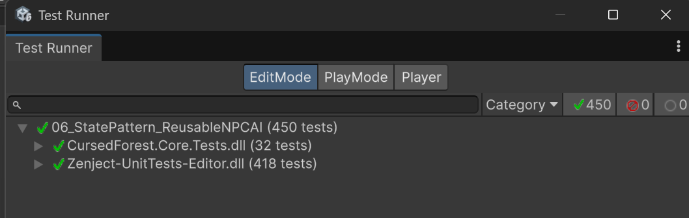

# Cursed Forest — Reusable NPC AI

https://github.com/user-attachments/assets/26dc7962-937a-4798-96f6-40dd542e55ff

**A data-driven NPC AI system for Unity, built around the State Pattern and a reusable finite state machine (FSM).**

Instead of implementing a single enemy with hardcoded behavior, this project explores how multiple NPC types can share the same state machine infrastructure while having different behaviors, perception rules, and transitions.

The implementation goes beyond a minimal State Pattern example to explore **separation of concerns, dependency injection, extensibility, and automated testing**.

## Project Overview

The scene features three types of NPCs:

| NPC | Behavior |
|---|---|
| **Monster** | Patrols, detects and chases targets, attacks, and rests when energy is low |
| **Villager** | Patrols and attempts to escape after being attacked |
| **Knight** | Responds when a villager is attacked, pursues the attacker, and engages in combat |

These NPCs use the same underlying FSM infrastructure but have different states, conditions, and capabilities.

One example interaction is a Monster attacking a Villager, causing the Villager to flee and the Knight to pursue the attacker.

## Key Features

- **Generic FSM core:** `StateMachine<TContext>`, `IState<TContext>`, and `StateTransition<TContext>` separate the state machine mechanism from specific gameplay logic.
- **Data-driven configuration:** ScriptableObjects define NPC states, conditions, and transitions.
- **Composable conditions:** Supports logical AND, OR, and NOT conditions for more expressive transitions.
- **Dependency injection:** Zenject manages NPC-specific dependencies.
- **Modular NPC capabilities:** Movement, perception, combat, health, and energy are represented by separate components and abstractions.
- **NavMesh-based navigation:** NPCs navigate their environment using Unity's navigation system.
- **Automated testing:** 32 Unity Edit Mode tests validate FSM behavior.

## Architecture

The project separates reusable state machine logic from Unity-specific NPC functionality.

### Core FSM

The core provides the fundamental state machine abstractions:

- `IState<TContext>` — defines the contract for states.
- `StateMachine<TContext>` — manages the active state and transitions.
- `StateTransition<TContext>` — represents conditional state transitions.
- `StateId` — identifies states.

The core is written in C# without requiring Unity-specific types.

### NPC AI Layer

The game-specific layer builds on this infrastructure using:

- `AgentContext` — provides access to the NPC's capabilities.
- `BrainDefinition` — describes an NPC's state machine configuration.
- `StateDefinition` — describes concrete state types.
- `ConditionDefinition` — describes transition conditions.
- `BrainBuilder` — constructs the runtime state machine from configuration.
- `AgentBrain` — integrates the FSM into the NPC lifecycle.

### High-level flow

```text
ScriptableObject Configuration
              |
              v
         BrainBuilder
              |
              v
  StateMachine<AgentContext>
         /          \
        v            v
      States      Conditions
        \            /
         v          v
          AgentContext
               |
      NPC Capabilities
   (Movement, Perception,
      Combat, Energy)
```

The generic FSM manages *when* states change. Concrete states and capabilities determine *what* an NPC actually does.

## The State Pattern in Practice

A basic State Pattern demonstration might use a single character with a few hardcoded transitions.

Cursed Forest explores a more extensible approach:

1. Each behavior is implemented as a separate state.
2. Transition conditions are evaluated independently of state behavior.
3. NPC-specific dependencies are accessed through an explicit context.
4. ScriptableObjects configure how behaviors are combined.
5. Different NPC types reuse the same FSM infrastructure.

For example, the same `Chase` behavior can be part of different NPC configurations without duplicating the state machine itself.

Adding new gameplay behavior may require implementing a new state, condition, or capability. **This is an intended extension point, not a requirement for the FSM core to understand every possible behavior.**

## Engineering Decisions and Trade-offs

### Why a generic FSM core?

It allows the state machine mechanism to remain separate from NPC-specific behavior and makes the core easier to test independently.

### Why ScriptableObjects?

They allow NPC behavior configurations to be represented as Unity assets instead of hardcoding every state and transition into a single controller.

### Why separate movement and perception?

State logic should not need to know the implementation details of navigation or target detection. Explicit abstractions reduce coupling between systems.

### Why dependency injection?

It makes dependencies explicit and supports NPC-specific configurations without relying on global lookups.

### What is the trade-off?

This architecture introduces more abstractions, classes, and setup than a simple `enum`-based FSM.

For a single NPC with a few fixed behaviors, that complexity may not be justified. The project deliberately explores the benefits and costs of a more extensible design.

## Testing

**32 Unity Edit Mode tests** cover the reusable FSM implementation.

The goal is to verify state machine behavior independently of the full gameplay scene and reduce the risk of introducing regressions when extending the system.



Unity Test Runner: 450 tests passed in total, including 32 project-specific FSM tests and 418 Zenject package tests.

## Technologies

- Unity 6.3
- C#
- State Pattern / Finite State Machine
- ScriptableObjects
- Zenject
- Unity NavMesh
- Unity Test Framework

## Learning Outcomes

This project focuses on more than implementing the State Pattern itself:

- Designing reusable state machine abstractions
- Separating domain logic from Unity-specific code
- Managing dependencies explicitly
- Creating data-driven NPC configurations
- Applying composition to transition conditions
- Testing reusable gameplay infrastructure
- Evaluating extensibility against architectural complexity

---

**The goal is not to create a universal AI framework, but to investigate how far the State Pattern can be extended into a maintainable NPC AI architecture—and where additional complexity becomes a trade-off.**